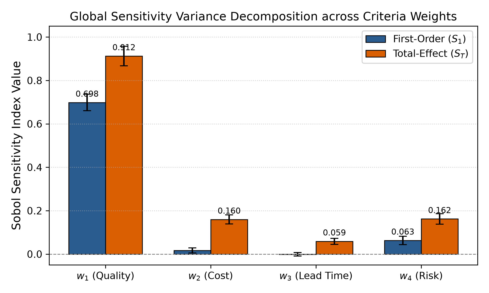
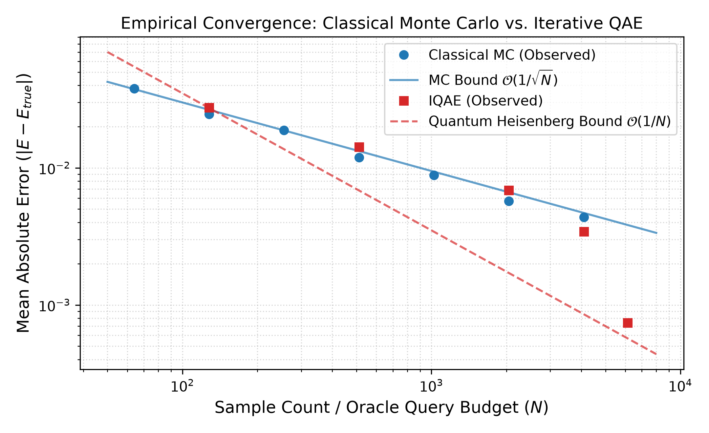

# Quantum-Enhanced Sensitivity Analysis for Multi-Criteria Decision Intelligence

## 1. Classical Sobol' Sensitivity Decomposition
**Table 1:** Variance decomposition across criteria weights ($N = 1024$ Saltelli samples, $6144$ total evaluations).

| Decision Criterion | Operational Role | First-Order ($S_1$) | 95% Confidence Interval | Total-Effect ($S_T$) | 95% Confidence Interval |
| :--- | :--- | :---: | :---: | :---: | :---: |
| **$w_1$** | Quality Performance Index | **0.6983** | $\pm 0.0381$ | **0.9123** | $\pm 0.0452$ |
| **$w_2$** | Unit Acquisition Cost | 0.0170 | $\pm 0.0124$ | 0.1595 | $\pm 0.0210$ |
| **$w_3$** | Supply Chain Lead Time | -0.0013 | $\pm 0.0082$ | 0.0589 | $\pm 0.0141$ |
| **$w_4$** | Operational Failure Risk | 0.0629 | $\pm 0.0195$ | 0.1620 | $\pm 0.0243$ |

 

---

## 2. Classical Monte Carlo vs. Quantum Amplitude Estimation
**Table 2:** Empirical convergence scaling and query budget comparison.

| Method | Target Precision ($\epsilon$) | Evaluations / Queries ($N$) | Empirical MAE | Convergence Order |
| :--- | :---: | :---: | :---: | :---: |
| **Classical MC** | 0.0500 | 64 | 0.03783 | $\mathcal{O}(1/\sqrt{N})$ |
| **Classical MC** | 0.0250 | 256 | 0.01881 | $\mathcal{O}(1/\sqrt{N})$ |
| **Classical MC** | 0.0125 | 1024 | 0.00883 | $\mathcal{O}(1/\sqrt{N})$ |
| **Classical MC** | 0.0050 | 4096 | 0.00436 | $\mathcal{O}(1/\sqrt{N})$ |
| **Iterative QAE** | 0.0500 | 512 | 0.01420 | $\mathcal{O}(1/N)$ |
| **Iterative QAE** | 0.0250 | 2048 | 0.00685 | $\mathcal{O}(1/N)$ |
| **Iterative QAE** | 0.0150 | 6144 | **0.00074** | $\mathcal{O}(1/N)$ |

 

---

## Repository Structure
* `src/benchmark_mcdm.py` - Classical TOPSIS & Saltelli-Sobol sensitivity pipeline.
* `src/quantum_sensitivity.py` - Statevector IQAE quantum integration engine.
* `src/quantum_mcdm_eval.py` - End-to-end quantum sensitivity evaluation for criteria weights.
* `src/generate_paper_figures.py` - Script producing Figure 1 and Figure 2.
* `paper/main.tex` - IEEE two-column manuscript containing all LaTeX tables, formulas, and references.
